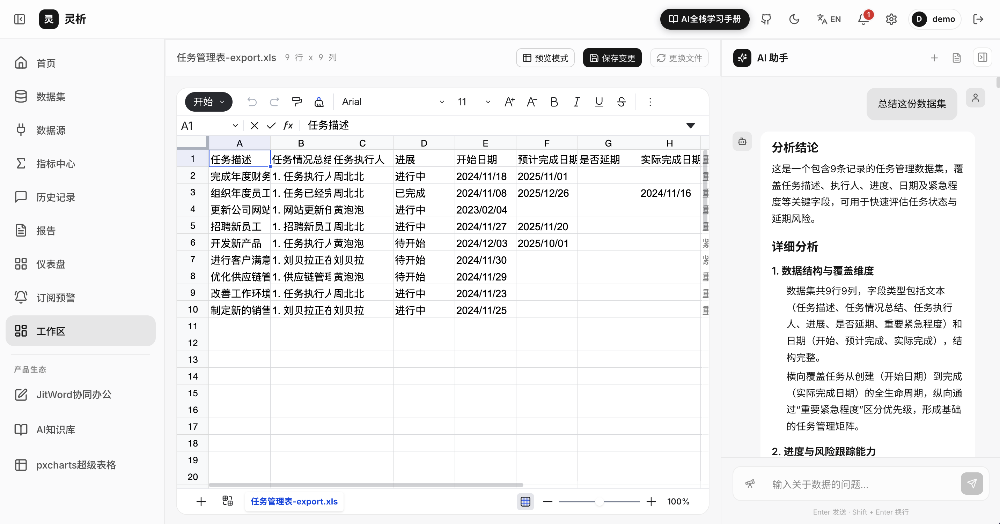
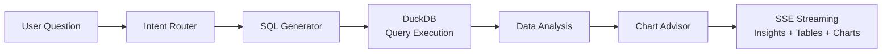

<div align="center">

# ✨ Aureka

**Open-source AI Data Analysis Platform · Upload a spreadsheet, analyze data like chatting**

Upload Excel / CSV files, ask questions in natural language, and let AI automatically generate SQL, charts, and analysis reports.
No coding required — instant insights, data value at your fingertips.

[](./LICENSE)
[](https://nodejs.org)
[](https://pnpm.io)
[](https://vuejs.org)
[](https://nestjs.com)
[](https://langchain-ai.github.io/langgraphjs/)
[](https://duckdb.org)
[](https://github.com/MrXujiang/opne-aureka/pulls)

[简体中文](./README.md) · **English** · [日本語](./README.ja.md)

[Quick Start](#-quick-start) · [Features](#-features) · [Architecture](#-architecture) · [Configuration](#%EF%B8%8F-configuration) · [Contributing](#-contributing)



</div>

---

## 🔗 More Open-source Projects

> If you like Aureka, feel free to check out the author's other open-source projects and products 👇

| Project | Description |
| --- | --- |
| 📝 [JitWord — Collaborative AI Docs](https://jitword.com) | Word-style AI document editor with knowledge base management and AI writing |
| 🎨 [H5-Dooring](https://github.com/MrXujiang/h5-Dooring) | Powerful open-source H5 visual page builder (LowCode / No-code) |
| 🗂 [JitKnow — AI Knowledge Base](https://know.jitword.com) | Multi-modal AI knowledge base supporting docs, spreadsheets, and rich media |

---

## 📖 Introduction

**Aureka** is an out-of-the-box **conversational data analysis platform (Chat BI)**:

1. 📤 Upload Excel / CSV datasets
2. 💬 Ask questions in natural language, e.g. *"Compare sales by channel over the last 3 months — which channel dropped the most?"*
3. 🤖 The AI Agent automatically handles **Intent Detection → SQL Generation → DuckDB Query → Data Analysis → Chart Recommendation**
4. 📊 Streams analysis conclusions, data tables, and ECharts visualizations in real time
5. 📑 Save insights as reports with one click, and revisit conversation history anytime

The whole process requires zero coding. All data stays local (SQLite + DuckDB) — **privacy-friendly and self-hosting ready**.

## ✨ Features

- 🗣 **Natural Language Queries**: Ask like chatting — questions are automatically translated into executable SQL
- 🧠 **Multi-intent Smart Routing**: Built-in intents for data query, comparison, attribution, anomaly detection, trend prediction, and statistics
- ⚡ **Streaming Experience**: SSE-based typewriter output — SQL / tables / charts / conclusions rendered stage by stage in real time
- 📊 **Smart Chart Recommendation**: Automatically picks the best chart type based on query results and renders with ECharts
- 🦆 **High-performance Analytics Engine**: Powered by DuckDB's columnar engine — aggregate millions of rows in seconds
- 📁 **Multi-format Data Import**: Upload Excel (.xlsx / .xls) and CSV files with automatic schema parsing
- 🔌 **Multi-LLM Support**: Compatible with OpenAI / DeepSeek / Qwen / Kimi and other mainstream LLMs — switch freely
- 📑 **Reports & History**: Save analysis results as reports and review past conversations anytime
- 🌍 **i18n**: Built-in Chinese / English interface
- 🔐 **Authentication**: JWT auth with [JitWord](https://next.jitword.com) SSO integration
- 🖥 **Beautiful UI**: Glassmorphism interface built with Vue 3 + UnoCSS

## 🏗 Architecture

### AI Agent Workflow



### Tech Stack

| Layer | Technologies |
| --- | --- |
| **Frontend** | Vue 3 · Vite · Pinia · Vue Router · UnoCSS · ECharts · vue-i18n |
| **Backend** | NestJS 10 · Passport JWT · SSE streaming |
| **AI Orchestration** | LangGraph · LangChain · Multiple LLM providers (OpenAI / DeepSeek / Qwen / Kimi) |
| **Data Engine** | DuckDB (analytics) · SQLite (metadata) · Keyv (cache) |
| **Tooling** | pnpm workspace · Turborepo · Full-stack shared TypeScript types |

### Project Structure

```
opne-aureka
├── apps
│   ├── server/                 # NestJS backend
│   │   └── src/modules
│   │       ├── agent/          # LangGraph AI Agent (intent routing / SQL gen / chart building)
│   │       ├── analysis/       # DuckDB analytics engine
│   │       ├── auth/           # JWT auth + JitWord SSO
│   │       ├── conversation/   # Conversation management (SSE streaming chat)
│   │       ├── dataset/        # Dataset upload & parsing
│   │       ├── report/         # Analysis reports
│   │       └── settings/       # LLM model configuration
│   └── web/                    # Vue 3 frontend
│       └── src
│           ├── components/     # Business components (chat panel / charts / data grid)
│           ├── composables/    # useSSE / useChart / useUpload
│           ├── stores/         # Pinia stores
│           └── views/          # Workspace / Datasets / Reports / History / Settings
└── packages
    └── shared/                 # Shared types & constants for frontend and backend
```

## 🚀 Quick Start

### Requirements

- Node.js >= 20
- pnpm >= 9 (`npm i -g pnpm`)

### One-click Launch

```bash
# Clone the repo
git clone https://github.com/MrXujiang/opne-aureka.git
cd opne-aureka

# One-click launch (auto-installs deps + creates .env + starts frontend & backend)
pnpm start
```

Once started, visit:

| Service | URL |
| --- | --- |
| 🖥 Frontend | http://localhost:5173 |
| ⚙️ Backend API | http://localhost:3000 |

### Manual Launch

```bash
pnpm install              # Install dependencies
cp .env.example .env      # Configure env vars (fill in your LLM API Key)

pnpm dev                  # Start frontend & backend together
pnpm dev:web              # Frontend only
pnpm dev:server           # Backend only
```

### Production Build

```bash
pnpm build                # Build everything
pnpm build:web            # Frontend only
pnpm build:server         # Backend only
```

## ⚙️ Configuration

Copy `.env.example` to `.env`. The LLM settings are the key part:

```bash
# LLM Provider (openai | deepseek | qwen | kimi)
LLM_PROVIDER=deepseek
LLM_API_KEY=your-api-key-here
LLM_BASE_URL=https://api.deepseek.com
LLM_MODEL=deepseek-chat
```

<details>
<summary>📄 Full configuration reference (click to expand)</summary>

| Variable | Description | Default |
| --- | --- | --- |
| `PORT` | Backend server port | `3000` |
| `DATABASE_URL` | Metadata database (SQLite) | `sqlite:./data/metadata.db` |
| `CACHE_STORE` | Cache driver (memory / sqlite) | `memory` |
| `STORAGE_DRIVER` | File storage driver | `local` |
| `UPLOAD_DIR` | Upload directory | `./uploads` |
| `DUCKDB_DATABASE` | DuckDB database file | `./data/analysis.duckdb` |
| `JWT_SECRET` | JWT secret (change it in production!) | - |
| `JWT_EXPIRES_IN` | Token expiration | `7d` |
| `JITWORD_BASE_URL` | JitWord SSO service URL | `https://next.jitword.com` |
| `LLM_PROVIDER` | LLM provider | `deepseek` |
| `LLM_API_KEY` | LLM API key | - |
| `LLM_MODEL` | Model name | `deepseek-chat` |
| `LLM_TEMPERATURE` | Sampling temperature | `0.1` |
| `LLM_MAX_TOKENS` | Max output tokens | `4096` |

</details>

## 🧭 How It Works

1. **Sign in**: Local account or JitWord SSO
2. **Upload data**: Upload Excel / CSV on the Datasets page — schema is parsed and imported into DuckDB automatically
3. **Ask questions**: Enter the workspace, pick a dataset, and ask in natural language, e.g.:
   - *"Total order amount by city, sorted descending"*
   - *"Compare Q1 vs Q2 sales and explain the change"*
   - *"Find dates with abnormal sales fluctuations"*
4. **View results**: AI streams its reasoning, SQL, data tables, and visual charts in real time
5. **Save reports**: Keep valuable insights as reports for your team to review

## 🗺 Roadmap

- [ ] Multi-table JOIN analysis
- [ ] Direct database connections (MySQL / PostgreSQL)
- [ ] Free-form dashboard composition
- [ ] Report export (PDF / image)
- [ ] One-click Docker deployment
- [ ] More chart types & custom themes

## 🤝 Contributing

Contributions of any kind are welcome!

1. Fork this repository
2. Create a feature branch: `git checkout -b feat/amazing-feature`
3. Commit your changes: `git commit -m 'feat: add amazing feature'`
4. Push the branch: `git push origin feat/amazing-feature`
5. Open a [Pull Request](https://github.com/MrXujiang/opne-aureka/pulls)

Found a bug? Feel free to open an [Issue](https://github.com/MrXujiang/opne-aureka/issues).

## 📄 License

This project is open-sourced under the [GPL-3.0](./LICENSE) license.

---

<div align="center">

**If this project helps you, please give it a ⭐️ Star!**

Made with ❤️ by [MrXujiang](https://github.com/MrXujiang)

</div>
