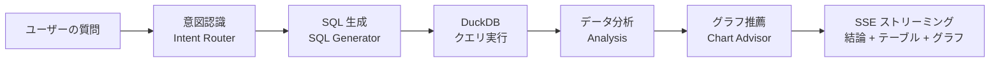

<div align="center">

# ✨ Aureka

**オープンソース AI データ分析プラットフォーム · 表をアップロードして、チャット感覚でデータ分析**

Excel / CSV をアップロードし、自然言語で質問するだけで、AI が SQL・グラフ・分析レポートを自動生成。
コーディング不要、即座にインサイトを獲得。データの価値を手のひらに。

[](./LICENSE)
[](https://nodejs.org)
[](https://pnpm.io)
[](https://vuejs.org)
[](https://nestjs.com)
[](https://langchain-ai.github.io/langgraphjs/)
[](https://duckdb.org)
[](https://github.com/MrXujiang/opne-aureka/pulls)

[简体中文](./README.md) · [English](./README.en.md) · **日本語**

[クイックスタート](#-クイックスタート) · [主な機能](#-主な機能) · [アーキテクチャ](#-アーキテクチャ) · [環境設定](#%EF%B8%8F-環境設定) · [コントリビュート](#-コントリビュート)


</div>

---

## 🔗 その他のオープンソースプロジェクト

> Aureka を気に入っていただけたら、作者の他のオープンソースプロジェクトやプロダクトもぜひご覧ください 👇

| プロジェクト | 概要 |
| --- | --- |
| 📝 [JitWord — コラボレーション AI ドキュメント](https://jitword.com) | Word ライクな AI ドキュメントエディタ。ナレッジベース管理と AI ライティングに対応 |
| 🎨 [H5-Dooring](https://github.com/MrXujiang/h5-Dooring) | 強力なオープンソース H5 ビジュアルページビルダー（ローコード / ノーコード） |
| 🗂 [JitKnow — AI ナレッジベース](https://know.jitword.com) | ドキュメント・表・マルチメディアを統合管理できるマルチモーダル AI ナレッジベース |

---

## 📖 プロジェクト概要

**Aureka** は、すぐに使える **対話型データ分析プラットフォーム（Chat BI）** です：

1. 📤 Excel / CSV データセットをアップロード
2. 💬 自然言語で質問（例：「直近 3 ヶ月のチャネル別売上を比較して、最も落ち込んだチャネルは？」）
3. 🤖 AI エージェントが **意図認識 → SQL 生成 → DuckDB クエリ → データ分析 → グラフ推薦** を自動実行
4. 📊 分析結果・データテーブル・ECharts グラフをリアルタイムにストリーミング出力
5. 📑 ワンクリックで分析レポートとして保存し、会話履歴もいつでも振り返り可能

すべての工程でコーディングは一切不要。データはすべてローカル（SQLite + DuckDB）に保存されるため、**プライバシーに配慮した設計で、セルフホスティングにも最適**です。

## ✨ 主な機能

- 🗣 **自然言語クエリ**：チャット感覚で質問するだけで、実行可能な SQL に自動変換
- 🧠 **マルチインテント・スマートルーティング**：データ照会・比較分析・要因分析・異常検知・トレンド予測・統計集計などの分析意図を内蔵
- ⚡ **ストリーミング体験**：SSE ベースのタイプライター式出力。SQL / テーブル / グラフ / 結論を段階的にリアルタイム表示
- 📊 **スマートグラフ推薦**：クエリ結果に基づいて最適なグラフタイプを自動選択し、ECharts で可視化
- 🦆 **高性能分析エンジン**：DuckDB のカラムナエンジンにより、数百万行のデータを秒単位で集計
- 📁 **マルチフォーマット対応**：Excel（.xlsx / .xls）と CSV のアップロードに対応、スキーマを自動解析
- 🔌 **マルチ LLM 対応**：OpenAI / DeepSeek / Qwen / Kimi などの主要 LLM に対応、自由に切り替え可能
- 📑 **レポート & 履歴**：分析結果をレポートとして保存し、過去の会話をいつでも確認可能
- 🌍 **多言語対応**：中国語 / 英語インターフェースを内蔵
- 🔐 **認証システム**：JWT 認証、[JitWord](https://next.jitword.com) SSO 連携に対応
- 🖥 **美しい UI**：Vue 3 + UnoCSS で構築されたグラスモーフィズムデザイン

## 🏗 アーキテクチャ

### AI エージェントワークフロー



### 技術スタック

| レイヤー | 技術 |
| --- | --- |
| **フロントエンド** | Vue 3 · Vite · Pinia · Vue Router · UnoCSS · ECharts · vue-i18n |
| **バックエンド** | NestJS 10 · Passport JWT · SSE ストリーミング |
| **AI オーケストレーション** | LangGraph · LangChain · マルチ LLM プロバイダー（OpenAI / DeepSeek / Qwen / Kimi） |
| **データエンジン** | DuckDB（分析クエリ）· SQLite（メタデータ）· Keyv（キャッシュ） |
| **開発ツール** | pnpm workspace · Turborepo · TypeScript フルスタック型共有 |

### ディレクトリ構成

```
opne-aureka
├── apps
│   ├── server/                 # NestJS バックエンド
│   │   └── src/modules
│   │       ├── agent/          # LangGraph AI エージェント（意図ルーティング / SQL 生成 / グラフ構築）
│   │       ├── analysis/       # DuckDB 分析エンジン
│   │       ├── auth/           # JWT 認証 + JitWord SSO
│   │       ├── conversation/   # 会話管理（SSE ストリーミングチャット）
│   │       ├── dataset/        # データセットのアップロードと解析
│   │       ├── report/         # 分析レポート
│   │       └── settings/       # LLM モデル設定
│   └── web/                    # Vue 3 フロントエンド
│       └── src
│           ├── components/     # ビジネスコンポーネント（チャットパネル / グラフ / データグリッド）
│           ├── composables/    # useSSE / useChart / useUpload
│           ├── stores/         # Pinia ストア
│           └── views/          # ワークスペース / データセット / レポート / 履歴 / 設定
└── packages
    └── shared/                 # フロントエンド・バックエンド共有の型と定数
```

## 🚀 クイックスタート

### 動作環境

- Node.js >= 20
- pnpm >= 9（`npm i -g pnpm`）

### ワンクリック起動

```bash
# リポジトリをクローン
git clone https://github.com/MrXujiang/opne-aureka.git
cd opne-aureka

# ワンクリック起動（依存関係の自動インストール + .env 作成 + フロント / バックエンド同時起動）
pnpm start
```

起動後、以下の URL にアクセスしてください：

| サービス | URL |
| --- | --- |
| 🖥 フロントエンド | http://localhost:5173 |
| ⚙️ バックエンド API | http://localhost:3000 |

### 手動起動

```bash
pnpm install              # 依存関係のインストール
cp .env.example .env      # 環境変数を設定（LLM API キーを入力）

pnpm dev                  # フロント / バックエンドを同時起動
pnpm dev:web              # フロントエンドのみ
pnpm dev:server           # バックエンドのみ
```

### プロダクションビルド

```bash
pnpm build                # 全体をビルド
pnpm build:web            # フロントエンドのみ
pnpm build:server         # バックエンドのみ
```

## ⚙️ 環境設定

`.env.example` を `.env` にコピーします。特に LLM の設定が重要です：

```bash
# LLM プロバイダー（openai | deepseek | qwen | kimi）
LLM_PROVIDER=deepseek
LLM_API_KEY=your-api-key-here
LLM_BASE_URL=https://api.deepseek.com
LLM_MODEL=deepseek-chat
```

<details>
<summary>📄 全設定項目リファレンス（クリックで展開）</summary>

| 変数 | 説明 | デフォルト値 |
| --- | --- | --- |
| `PORT` | バックエンドサーバーのポート | `3000` |
| `DATABASE_URL` | メタデータ DB（SQLite） | `sqlite:./data/metadata.db` |
| `CACHE_STORE` | キャッシュドライバー（memory / sqlite） | `memory` |
| `STORAGE_DRIVER` | ファイルストレージドライバー | `local` |
| `UPLOAD_DIR` | アップロードディレクトリ | `./uploads` |
| `DUCKDB_DATABASE` | DuckDB データベースファイル | `./data/analysis.duckdb` |
| `JWT_SECRET` | JWT シークレット（本番環境では必ず変更） | - |
| `JWT_EXPIRES_IN` | トークンの有効期限 | `7d` |
| `JITWORD_BASE_URL` | JitWord SSO サービス URL | `https://next.jitword.com` |
| `LLM_PROVIDER` | LLM プロバイダー | `deepseek` |
| `LLM_API_KEY` | LLM API キー | - |
| `LLM_MODEL` | モデル名 | `deepseek-chat` |
| `LLM_TEMPERATURE` | サンプリング温度 | `0.1` |
| `LLM_MAX_TOKENS` | 最大出力トークン数 | `4096` |

</details>

## 🧭 利用の流れ

1. **ログイン**：ローカルアカウントまたは JitWord SSO でログイン
2. **データのアップロード**：データセットページで Excel / CSV をアップロード。スキーマが自動解析され DuckDB にインポートされます
3. **質問する**：ワークスペースでデータセットを選択し、自然言語で質問します。例：
   - *「都市別の注文合計金額を降順で集計して」*
   - *「Q1 と Q2 の売上を比較して、変化の要因を分析して」*
   - *「売上が異常に変動した日を見つけて」*
4. **結果の確認**：AI が分析の思考プロセス・SQL・データテーブル・グラフをリアルタイムに出力
5. **レポートとして保存**：価値ある分析をレポートとして保存し、チームで共有・振り返り

## 🗺 ロードマップ

- [ ] 複数テーブルの JOIN 分析
- [ ] データベース直接接続（MySQL / PostgreSQL）
- [ ] ダッシュボードの自由レイアウト
- [ ] レポートエクスポート（PDF / 画像）
- [ ] Docker ワンクリックデプロイ
- [ ] グラフタイプの追加とカスタムテーマ

## 🤝 コントリビュート

あらゆる形での貢献を歓迎します！

1. このリポジトリを Fork
2. フィーチャーブランチを作成：`git checkout -b feat/amazing-feature`
3. 変更をコミット：`git commit -m 'feat: add amazing feature'`
4. ブランチをプッシュ：`git push origin feat/amazing-feature`
5. [Pull Request](https://github.com/MrXujiang/opne-aureka/pulls) を作成

バグを見つけたら、お気軽に [Issue](https://github.com/MrXujiang/opne-aureka/issues) を作成してください。

## 📄 ライセンス

本プロジェクトは [GPL-3.0](./LICENSE) ライセンスの下で公開されています。

---

<div align="center">

**このプロジェクトが役に立ったら、ぜひ ⭐️ Star で応援してください！**

Made with ❤️ by [MrXujiang](https://github.com/MrXujiang)

</div>
